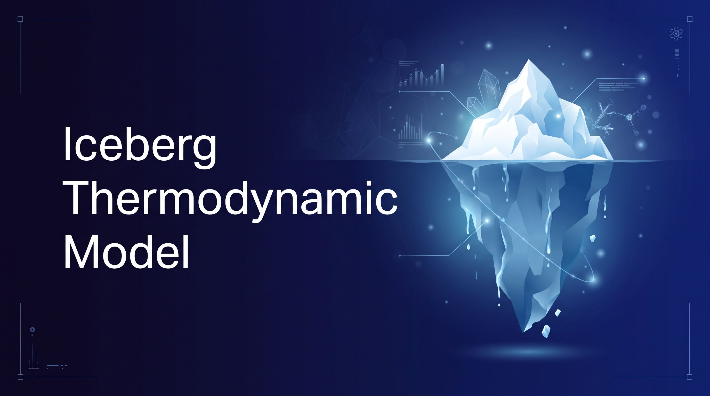

<div style="text-align: center;">
  <a>
    
  </a>
</div>

<h1 align="center">Iceberg Thermodynamic Model</h1>


<hr>

## 📋 Description

Master's thesis project on modernizing and supplementing the Thermodynamic
Model of Icebergs for modeling processes in the Arctic Ocean (original model
by Dmitrev, 1995).

The repository contains a **Lagrangian iceberg module** embedded in a legacy
Eulerian ocean/sea-ice modeling framework. The iceberg is represented as a
rectangular prism whose position, velocity, and dimensions evolve in time
under atmospheric, oceanic, bathymetric, and sea-ice forcing.

## 📑 Project status

- **Current stage:** **Stage 11 FROZEN** as a research artifact; **Stage 12 active**, completed through Stage 12.8 validation, Stage 12.9a acquisition, Stage 12.10 voxel-boundary improvements, the Stage 12.11 final audit, the Stage 12.12 resolution/geometry audit, and the Stage 12.13 voxel/prism convergence audit, the Stage 12.14 100^3 annual/convergence audit, the Stage 12.15/12.16 Enderlin/drift/ensemble audits, and the Stage 12.17 drag correction; Stage 12.18 adds the 12-run 50 m grounded-in-place final matrix and thesis figures (voxel iceberg on GLORYS12 + ERA5, offline/one-way). Stage 12.9b thesis writing is GO with fallback labeling.
- **Validation boundary:** Stage 12.8 used monthly-mean GLORYS and a constant atmosphere; its drift and lifetime are lower bounds, not daily-forcing validation. The Stage 11 ocean is not production-validated.
- **Physics default:** EOS-80 (`EOS_MODE` unset); `EOS_MODE=LEGACY` is the historical fallback. See [`docs/model/model_physics_status.md`](docs/model/model_physics_status.md).
- **Start here:** [`docs/README.md`](docs/README.md); active work: [`docs/validation/INDEX.md`](docs/validation/INDEX.md).

## 🔧 Repository components

| Component                                          | Purpose                                                                               |
| -------------------------------------------------- | ------------------------------------------------------------------------------------- |
| `src/`                                             | Model source code (Fortran): ocean/ice framework, `iceberg_*.f90` — Lagrangian module |
| `app/main.f90`                                     | Orchestrator: time loop, forcing, output                                              |
| `test/`                                            | Fortran tests (fpm)                                                                   |
| `python/validation/`                               | Independent Python reference models and cross-language comparisons                    |
| `python/tests/`                                    | Python tests for the validation layer                                                 |
| `python/analysis/`, `python/era5/`, `python/grid/` | Analysis, ERA5 download, real-grid generation                                         |
| `data/`                                            | Input data (ERA5, EN4, IBCAO, observations) and run outputs (gitignored)              |
| `docs/`                                            | Documentation: model, validation, stage archive                                       |

## 🚀 Quick start

```bash
# Build and test (always with -I/usr/include; rm -rf build before fpm test)
fpm test --flag "-I/usr/include"

# Strict build
fpm build --flag "-I/usr/include -Wall -Wextra -fcheck=all -ffpe-trap=invalid,zero,overflow"

# Run (EOS-80 is the default from Stage 11.8B)
fpm run --flag "-I/usr/include" -- <run_id> [era5_file]

# Legacy regression / comparison
EOS_MODE=LEGACY fpm run --flag "-I/usr/include" -- <run_id> [era5_file]

# After a fresh clone, regenerate the real-grid inputs (three steps:
# 0 conditional, then 1 and 2):
# 0. Prerequisite: data/input/raw/ibcao/ibcao_v5_2_2026_depth_400m.tiff
#    (IBCAO V5.2, downloaded separately) must exist. If
#    data/input/processed/grid/ibcao_model_grid.nc does not exist,
#    download the tiff first and build it below; otherwise skip to step 1:
python python/grid/build_ibcao_grid.py
# 1. Legacy .DAT/.bar/.ice files are OFFLINE REGRESSION ONLY from Stage 11.10.
#    Production uses NetCDF grid.nc / initial_ts.nc / seaice_initial.nc.
#    No root-level symlinks are required.
```

Python: conda environment `iceberg-thermodynamic-model`
(`conda activate iceberg-thermodynamic-model`).

## 🗺️ Documentation navigation

```
README.md
  └─ docs/README.md                     documentation map
      ├─ model/README.md                current physics and equations
      ├─ validation/INDEX.md            active, unfinished work
      ├─ wiki/INDEX.md                  completed stages 3–12
      ├─ DECISIONS.md                   decision journal
      ├─ references/README.md           literature and data sources
      ├─ references/reanalysis_data_plan.md  Stage 12 data contract
      └─ archive/README.md              superseded plans and provenance
```

| Looking for | Go to |
| --- | --- |
| Agent and project constraints | [`AGENTS.md`](AGENTS.md) |
| Development and commit process | [`RULES.md`](RULES.md) |
| Code and documentation style | [`STYLE.md`](STYLE.md) |
| Current known issues | [`KNOWN_ISSUES.md`](KNOWN_ISSUES.md) |
| Change history | [`CHANGELOG.md`](CHANGELOG.md) |
| Physics status and switches | [`docs/model/model_physics_status.md`](docs/model/model_physics_status.md) |
| Current active work | [`docs/validation/INDEX.md`](docs/validation/INDEX.md) |
| Completed stage reports | [`docs/wiki/INDEX.md`](docs/wiki/INDEX.md) |
| Stage 11 frozen boundary | [`docs/wiki/stages/stage11/STAGE11_FREEZE.md`](docs/wiki/stages/stage11/STAGE11_FREEZE.md) |
| Full documentation map | [`docs/README.md`](docs/README.md) |

## 🔗 References

- License: `LICENSE`
- Key decisions: `docs/DECISIONS.md`
- Full documentation map: `docs/README.md`

<hr>

⭐ **If you find this project useful, please give it a star!**
